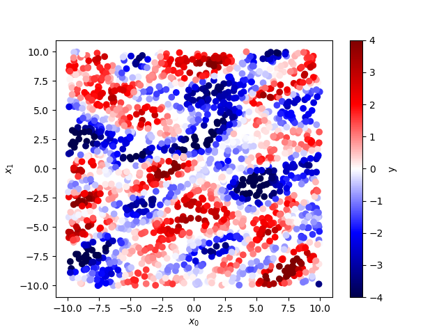
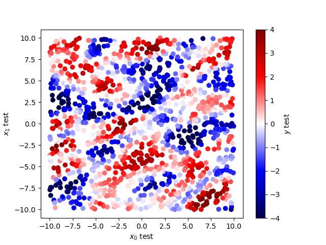
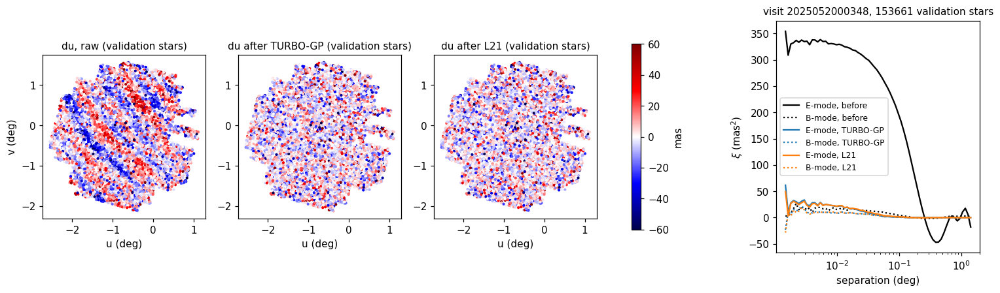

################
Gaussian Process interpolation using treegp
################

Quick start
===========

Here is a simple example of a 2D gaussian process interpolation 
using ``treegp``. Before showing how to use ``treegp``, the interpolation needs 
to be perform over some data and we will simulate some Gaussian random field below. 
In the block bellow you can find how: 

- How to generate a 2d anisotropic gaussian random field
- How to write the correlation length matrix in terms of the isotropic correlation lenght and shear parameters (:math:`g_1`, :math:`g_1`); see `Léget et al 2021 <https://doi.org/10.1051/0004-6361/202140463>`_

.. code:: ipython3

    import numpy as np
    import treegp
    from treegp import AnisotropicRBF
    import matplotlib.pyplot as plt

    def get_correlation_length_matrix(size, g1, g2):
        """
        Produce correlation matrix to introduce anisotropy in kernel.
        Used same parametrization as shape measurement in weak-lensing
        because this is mathematicaly equivalent (anistropic kernel
        will have an elliptical shape).

        :param correlation_length: Correlation lenght of the kernel.
        :param g1, g2:             Shear applied to isotropic kernel.
        """
        if abs(g1) > 1:
            g1 = 0
        if abs(g2) > 1:
            g2 = 0
        g = np.sqrt(g1**2 + g2**2)
        q = (1 - g) / (1 + g)
        phi = 0.5 * np.arctan2(g2, g1)
        rot = np.array([[np.cos(phi), np.sin(phi)], [-np.sin(phi), np.cos(phi)]])
        ell = np.array([[size**2, 0], [0, (size * q) ** 2]])
        L = np.dot(rot.T, ell.dot(rot))
        return L

    def make_2d_grf(kernel, noise=None, seed=42, npoints=40):
        """
        Function to generate a 2D gaussian random field for a
        given scikit-learn kernel.

        :param kernel:  given sklearn kernel.
        :param noise:   float. Level of noise to add to the
                        gaussian randomn field. (default: None)
        :param seed:    int. seed of the random process. (default: 42)
        :param npoints: int. number of points to generate for the
                        simulations.
        """
        # fixing the seed
        np.random.seed(seed)
        # generate random 2D coordinate
        x1 = np.random.uniform(-10, 10, npoints)
        x2 = np.random.uniform(-10, 10, npoints)
        x = np.array([x1, x2]).T
        # creating the correlation matrix / kernel
        K = kernel.__call__(x)
        # generating gaussian random field
        y = np.random.multivariate_normal(np.zeros(npoints), K)
        if noise is not None:
            # adding noise
            y += np.random.normal(scale=noise, size=npoints)
            y_err = np.ones_like(y) * noise
            return x, y, y_err
        else:
            return x, y, None

    L = get_correlation_length_matrix(2., 0.3, 0.3)
    invL = np.linalg.inv(L)
    kernel = 2**2 * AnisotropicRBF(invLam=invL)
    x, y, y_err = make_2d_grf(kernel, noise=0.1, seed=42, npoints=2000)
    plt.scatter(x[:,0], x[:,1], c=y, cmap=plt.cm.seismic, vmin=-4, vmax=4)
    cb = plt.colorbar()
    cb.set_label('y')
    plt.xlabel('$x_0$')
    plt.ylabel('$x_1$')

To do the gaussian process interpolation with ``treegp`` it follow this API: 

.. code:: ipython3

    kernel_treegp = "2**2 * AnisotropicRBF(invLam={0!r})".format(invL)

    gp = treegp.GPInterpolation(
                kernel=kernel_treegp,
                optimizer="anisotropic",
                normalize=True,
                nbins=21,
                min_sep=0.0,
                max_sep=1.0,
                p0=[6., 0.0, 0.0],
            )
    # feed with data treegp
    gp.initialize(x, y, y_err=y_err)
    # solve for hyperparameters 
    gp.solve()

    # test on test position and compute GP interpolation on it.
    x1_test = np.random.uniform(-10, 10, 1500)
    x2_test = np.random.uniform(-10, 10, 1500)
    x_test = np.array([x1_test, x2_test]).T
    y_test, y_test_cov = gp.predict(x_test, return_cov=True)

TURBO-GP: using the measured 2-points correlation function as the kernel
========================================================================

Instead of fitting the hyperparameters of a parametric kernel on the
measured 2-points correlation function (`Léget et al 2021
<https://doi.org/10.1051/0004-6361/202140463>`_), the measured anisotropic 2D
2-points correlation function can be used directly as the kernel, following
`Gomes et al 2025 <https://doi.org/10.3847/1538-3881/ae1a7b>`_. This is
TURBO-GP (TUrbulence Removal By fourier-Optimized Gaussian Process), described
in `RTN-129 <https://rtn-129.lsst.io>`_ and explained step by step, with
interactive demos, at https://pfleget.github.io/treegp/. The measured
correlation function is cleaned by apodization and thresholding of its
Fourier power spectrum and tabulated on a grid. No hyperparameters are
fitted, so the ``kernel`` argument is ignored; the grid is controlled by
``max_sep`` (half width) and ``pixel_size``.

By default (``solve_method="spectral"``) the Gaussian process is then solved
on a fine grid: the training points are spread on the grid with bilinear
weights, the covariance between grid nodes is a convolution by the tabulated
kernel done with a zero-padded FFT (whose spectrum is clipped once to be
non-negative, so the kernel is positive semi-definite by construction), the
weights are solved by a Jacobi-preconditioned conjugate gradient, and the
posterior mean is computed once as a grid field, so that prediction is cheap
whatever the number of training points. ``solve_method="direct"`` uses the
dense covariance matrix instead (clipping its negative eigenvalues), and is
the path taken when ``return_cov=True``:

.. code:: ipython3

    gp = treegp.GPInterpolation(
                optimizer="empirical-2pcf",
                normalize=True,
                max_sep=6.0,
                pixel_size=0.5,
            )
    gp.initialize(x, y, y_err=y_err)
    # measure, clean, and tabulate the 2-points correlation function
    gp.solve()
    y_test, y_test_cov = gp.predict(x_test, return_cov=True)

    # measured and cleaned correlation functions can be inspected with:
    xi, xi_clean, distance, pixel_size = gp.return_empirical_2pcf()

Worked example: L21 and TURBO-GP on a real LSSTCam visit
========================================================

The interactive slides at https://pfleget.github.io/treegp/ are built from one
real LSSTCam visit (visit 2025052000348, z band, 163 661 stars; the example
data distributed by Gomes et al. 2025 with their code): the
astrometric residuals ``du``, ``dv`` of each star (in mas, with their
measurement errors) at the tangent-plane positions ``u``, ``v`` (in degrees).
The residuals are dominated by atmospheric turbulence, a smooth, anisotropic
field that both methods try to interpolate from a subset of the stars. The
same data file is shipped with the slides and can be downloaded (3.4 MB):

.. code:: ipython3

    import urllib.request
    import numpy as np
    import treegp
    from treegp.utils import comp_eb_treecorr

    url = "https://pfleget.github.io/treegp/data/rubin_visit_2025052000348.npz"
    urllib.request.urlretrieve(url, "rubin_visit_2025052000348.npz")
    visit = np.load("rubin_visit_2025052000348.npz")
    u, v = np.asarray(visit["u"], float), np.asarray(visit["v"], float)
    du, dv = np.asarray(visit["du"], float), np.asarray(visit["dv"], float)
    du_err, dv_err = np.asarray(visit["du_err"], float), np.asarray(visit["dv_err"], float)

    # 10 000 random stars train the Gaussian process, the others validate it
    X = np.vstack([u, v]).T
    rng = np.random.default_rng(1234)
    perm = rng.permutation(len(X))
    train, val = perm[:10000], perm[10000:]

**Léget et al. 2021** (``optimizer="anisotropic"``): an anisotropic von
Kármán kernel whose hyperparameters (amplitude, correlation length and the
two shear parameters of the anisotropy) are fitted on the measured
two-point correlation function of the training stars. The correlation
function is measured with TreeCorr on a 21 x 21 grid out to ``max_sep``
(0.3 degree here) and bootstrapped for its errors, which is what makes this
step slow (about 25 minutes per component for 10 000 stars). Each component
of the displacement is an independent Gaussian process:

.. code:: ipython3

    def run_l21(X, y, y_err):
        gp = treegp.GPInterpolation(
            kernel="15**2 * AnisotropicVonKarman(invLam=array([[1./0.8**2,0],[0,1./0.8**2]]))",
            optimizer="anisotropic",
            normalize=True,
            nbins=21,
            min_sep=None,
            max_sep=0.3,
            p0=[0.3, 0.0, 0.0],  # initial correlation length (deg), g1, g2
        )
        gp.initialize(X, y, y_err=y_err)
        gp.solve()   # measure the 2-pcf, fit the kernel, solve for the weights
        return gp

    gp_u = run_l21(X[train], du[train], du_err[train])
    gp_v = run_l21(X[train], dv[train], dv_err[train])
    pred_u_l21 = gp_u.predict(X[val])
    pred_v_l21 = gp_v.predict(X[val])
    print(gp_u.kernel)   # the fitted kernel

**TURBO-GP** (``optimizer="empirical-2pcf"``): the measured 2D correlation
function itself is the kernel. It is measured with 20" pixels out to
``max_sep``, cleaned (apodization with a Hann window of radius
``apod_radius`` whose anisotropy is measured on the map itself, Fourier
transform, modes below ``power_threshold`` times the noise set to zero,
transform back) and tabulated. Nothing is fitted, so the ``kernel`` argument
is not given. The Gaussian process is then solved on a 10" grid with the FFT
and a preconditioned conjugate gradient (``solve_method="spectral"``, the
default): a few seconds per component for the same 10 000 stars, and the
cost grows almost linearly with the number of stars.

.. code:: ipython3

    def run_turbogp(X, y, y_err):
        gp = treegp.GPInterpolation(
            optimizer="empirical-2pcf",
            normalize=True,
            max_sep=0.3,                 # half width of the correlation map (deg)
            pixel_size=20.0 / 3600.0,    # its pixel (deg)
            apodize=True,
            apod_window="hann",
            apod_radius=0.278,
            apod_anisotropy="auto",
            power_threshold=2.5,
        )
        gp.initialize(X, y, y_err=y_err)
        gp.solve()   # measure, clean and tabulate the kernel, solve by conjugate gradient
        return gp

    gp_u = run_turbogp(X[train], du[train], du_err[train])
    gp_v = run_turbogp(X[train], dv[train], dv_err[train])
    pred_u_turbo = gp_u.predict(X[val])
    pred_v_turbo = gp_v.predict(X[val])
    # the measured and cleaned correlation maps (108 x 108 pixels of 20")
    xi, xi_clean, lags, pixel_size = gp_u.return_empirical_2pcf()

Both corrections are compared on the validation stars through the E/B-mode
decomposition of the two-point correlation function of the residuals
(``comp_eb_treecorr``; turbulence is a pure E-mode, curl-free, field):

.. code:: ipython3

    kw = dict(rmin=5.0 / 3600.0, rmax=1.5, dlogr=0.1)
    xie0, xib0, logr = comp_eb_treecorr(u[val], v[val], du[val], dv[val], **kw)
    xie1, xib1, _ = comp_eb_treecorr(
        u[val], v[val], du[val] - pred_u_turbo, dv[val] - pred_v_turbo, **kw
    )
    xie2, xib2, _ = comp_eb_treecorr(
        u[val], v[val], du[val] - pred_u_l21, dv[val] - pred_v_l21, **kw
    )
    for name, xie in (("before", xie0), ("TURBO-GP", xie1), ("L21", xie2)):
        print(f"{name:9s} E-mode at the smallest separations: {np.mean(xie[:4]):5.0f} mas^2")

On this visit the E-mode variance at the smallest separations goes from
about 330 mas\ :sup:`2` before correction to about 30 mas\ :sup:`2` after
either Gaussian process (the two kernels give the same quality here; the
difference is the cost, and the fact that TURBO-GP has no parametric shape
to fit). The remaining scatter per star is the ~13 mas measurement noise of the
sources, which is uncorrelated between stars and therefore absent from
the correlation function.

The complete script (``slides/example_l21_turbogp.py`` in the repository,
``--no-l21`` skips the slow fit) produces this figure.

